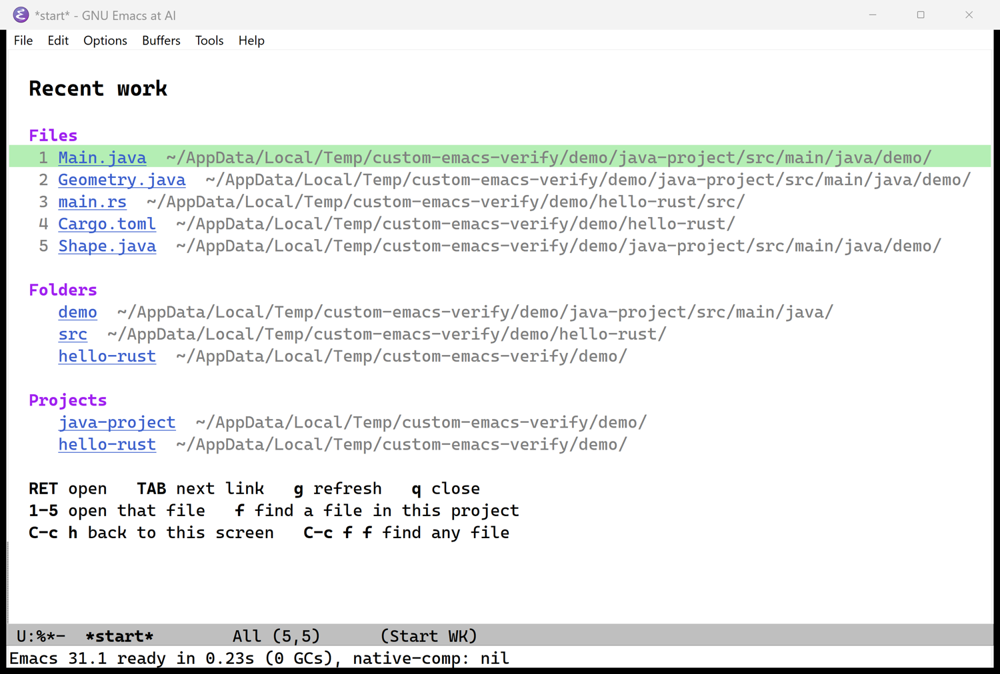
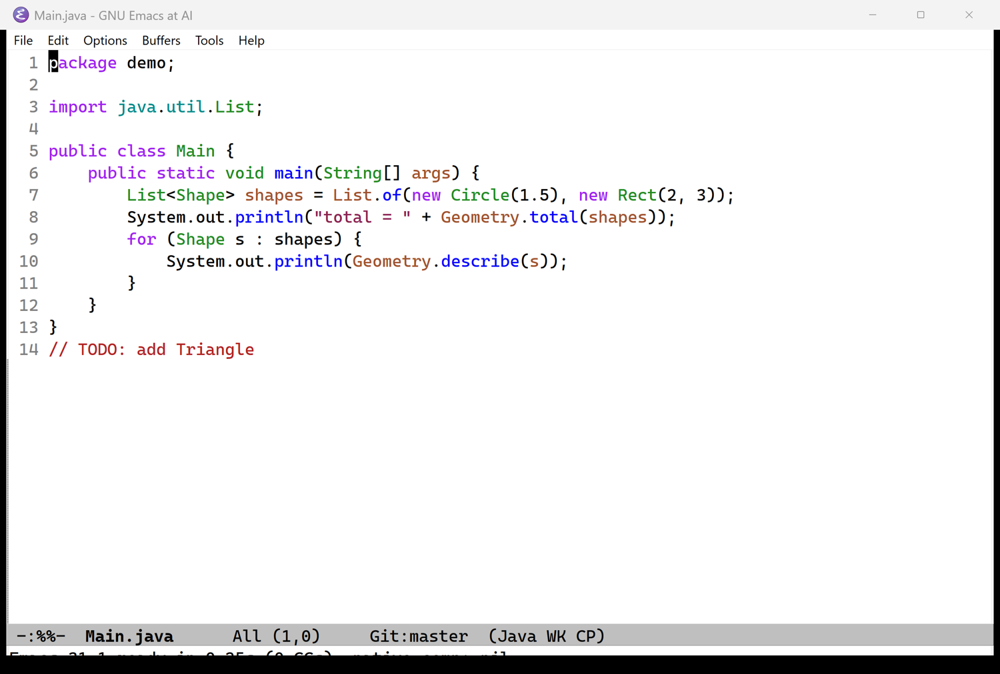
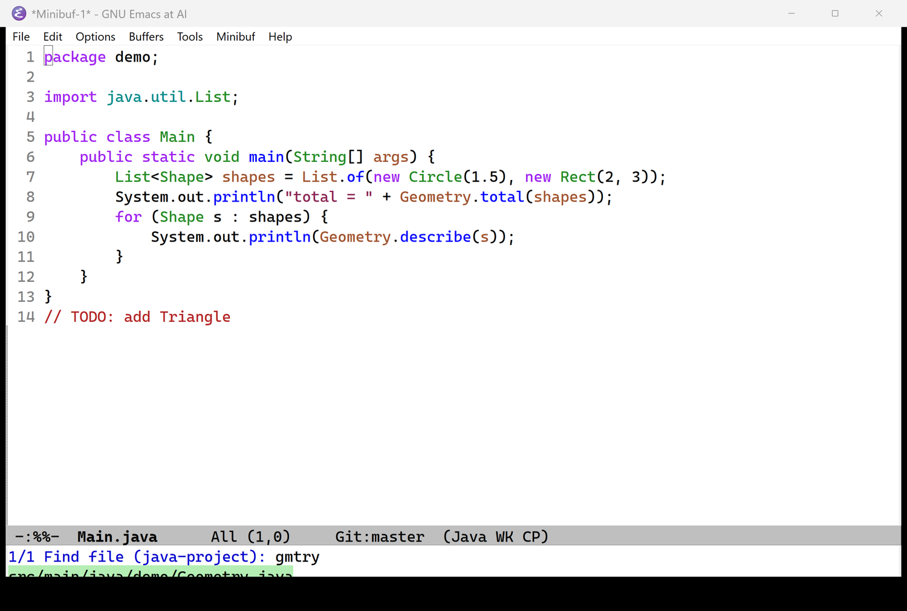
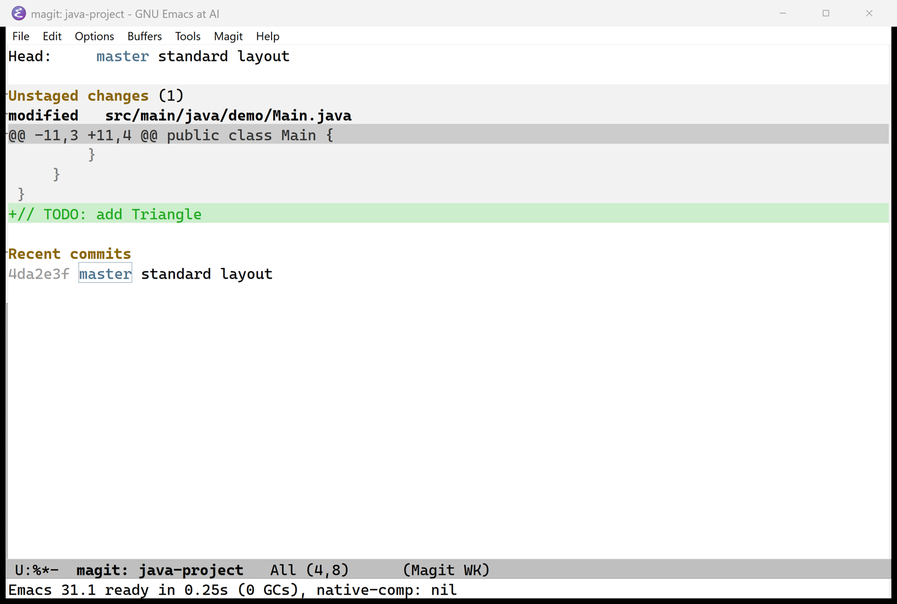
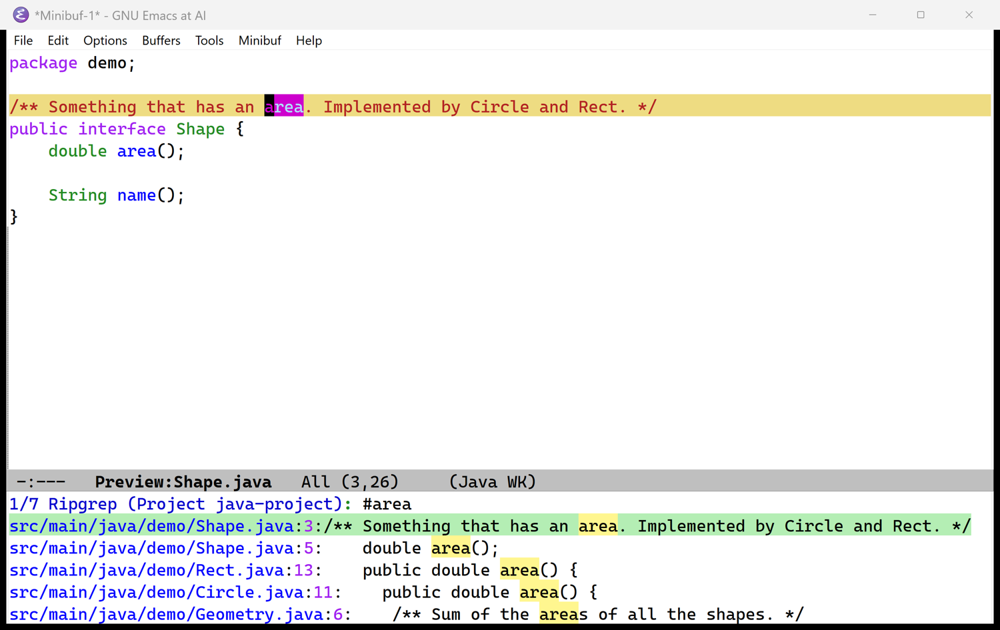
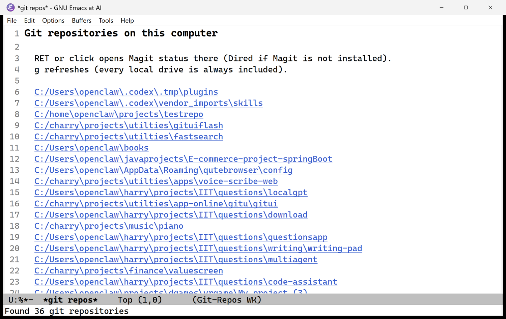

# Portable bundles: unzip and run

A bundle is one zip that holds Emacs, your settings, the packages and the helper programs. You unzip it
anywhere and open `Emacs.exe`. Nothing is installed and nothing is downloaded.

| Bundle | File | Status |
|---|---|---|
| **Windows 10/11, 64-bit** | `custom-emacs-windows-x64.zip` (about 247 MB zipped, 644 MB unpacked, with Java) | **Built and tested**, described below |
| **Linux x86-64** | `custom-emacs-linux-x86_64.tar.gz`/`.zip` (about 146/153 MB, 410 MB unpacked) | **Built and tested**, see [Linux](#linux) |
| **macOS, Apple Silicon (arm64)** | `custom-emacs-macos-arm64.zip` (about 121 MB zipped, 348 MB unpacked) | **Built and tested**, see [macOS](#macos) |

Each archive is in `dist/` after `./build.sh dist windows`/`./build.sh dist linux`/`./build.sh dist macos` and
is **not** committed to git (each is over 100 MB and rebuilt from what is in git). All three platforms are
built and published to the same GitHub Release automatically by `.github/workflows/release.yml` (push a tag,
or run it manually from the Actions tab) -- Windows reuses `test.yml`'s own `test-windows` recipe (WSL on a
`windows-latest` runner, which `tools/dist-windows.sh` itself needs) to build it in CI too, not just locally.

## Windows

### Using it

1. Unzip `custom-emacs-windows-x64.zip` anywhere you can write (Desktop, `C:\Tools`, a USB stick).
2. Double-click **`Emacs.exe`**.

That is all. It opens on the start screen ([START-SCREEN.md](START-SCREEN.md)):



Everything else behaves as in the Linux guides: Java highlighted by tree-sitter, the fast finder on
`C-c f f`, Magit on `C-x g`, Consult on `C-c s l/g/f/b`, and finding every git repository on the computer
with `C-c f p` — drawn instantly from a saved index (like the recent-files list), refreshed in the
background; on Windows this runs the bundled `fd.exe` directly across every local drive letter, no
shell script needed (found 36 real repositories on the machine this was tested on). Each result opens
with Magit, Dired or Treemacs (`RET`/click, `d`, `t`).









*`C-c s g area`: the same live-preview results list as on Linux, using the bundled `rg`.*



*`C-c f p`: the bundled `fd.exe` found 36 real repositories across this machine's drives; clicking one opens Magit.*

*These are real screenshots of the unpacked bundle. The demo project and history are examples.*

### What is inside

```
custom-emacs-windows-x64/
├── Emacs.exe          the launcher you double-click (76 KB; source: tools/windows-launcher.c)
├── emacs/             GNU Emacs 31.1 for Windows, the official unmodified build, with all its libraries
├── config/            your settings: early-init.el, init.el, fastfind.el, startpage.el, docsbuffer.el, gitfolders.el
│   ├── elpa/          Evil, Magit, Treemacs and Consult (and their helpers), compiled by the Windows Emacs
│   └── tree-sitter/   grammars for Windows: Java, Rust, HTML, CSS, JavaScript/JSX, TypeScript/TSX, JSON
├── tools/
│   ├── git/           MinGit 2.55: Git for Magit, with its own small shell
│   ├── rg/            ripgrep: the fast finder, project text search, and Consult
│   ├── fd/            fd: file finding for Consult (`C-c s f`) and for finding git repositories (`C-c f p`)
│   ├── fonts/         all 20 `C-c F` fonts, real files --- select them all, right-click, Install (see tools/fonts/README.md)
│   ├── pdf-tools/     epdfinfo.exe + every DLL it needs, real PDF text/search with zero install (see tools/pdf-tools/README.md)
│   ├── jdtls/         the Java language server (needs your own JDK 17+ on PATH/JAVA_HOME; not bundled)
│   ├── node-windows/  a real Windows-native Node.js runtime (dev-ui-ai branch only)
│   └── node-lsp/      the JS/TS/HTML/CSS/Angular language servers + Angular/Nest CLIs, built for Windows (dev-ui-ai branch only)
├── docs/              every guide, plain text, read from inside Emacs with `C-c d` (see below)
├── README.md          this project's own overview (also inside the `C-c d` buffer)
├── README.txt         this bundle's own quick-start
└── DISTRIBUTION.md    this guide
```

What `Emacs.exe` does when you start it: finds its own folder; puts the bundled Git, ripgrep and fd first on
`PATH`; sets `HOME` to your user profile if it is not set, so `~` means `C:\Users\you`; and starts
`emacs\bin\runemacs.exe` (Emacs without a console window) pointing at `config\`. Files or options you give
`Emacs.exe` are passed on to Emacs, so `Emacs.exe notes.txt` opens that file.

**Every guide is inside Emacs itself.** Press `C-c d` for a single buffer, `*docs*`, holding this project's
README and every `docs\*.md` guide, folded with `outline-mode` and with a clickable table of contents. It is
built the moment Emacs starts (about 2 ms; measured identical content on Windows and Linux, 257,570
characters), so it is there even with no network. See [CUSTOMIZING.md](CUSTOMIZING.md).

**Your changes are saved in the bundle's `config\` folder**: recent files, the folder and project history,
backups and anything `M-x customize` saves. Copying or moving the whole folder moves them with it. It also
means the folder must be writable, so do not put it under `C:\Program Files`.

**Fonts (`C-c F`) need one extra, one-time step.** A font is an OS resource, not something
Emacs can install for itself --- `tools\fonts\` holds all 20 real font files (`.ttf`, `.otf`
and one `.ttc`), but nothing on the machine actually HAS them until you install them: select
every file in `tools\fonts\` (`Ctrl-A`), right-click, **Install** (no administrator rights
needed). A few seconds, then restart Emacs. See `tools\fonts\README.md` (a plain text file
right there in that folder) for how each one was sourced and its real license.

### How it differs from the Linux build

| | Linux (this repository's build) | Windows bundle |
|---|---|---|
| Emacs | 32.0.50, built from source here | **31.1**, the official GNU build for Windows |
| Native compilation | yes (built-in code is native) | **no**: the official Windows build does not include it, so packages run byte-compiled |
| Speed | startup 0.05 s (measured, headless) | 0.23 s until the window is ready, measured in a real window |
| Line endings for new files | LF | LF: the config sets UTF-8 with LF on Windows (Windows Emacs would otherwise write CRLF). Files that already have CRLF keep them |
| Whole-disk file index | the whole `/`, minus system folders | the drive of your home folder (normally `C:\`), minus `Windows`, `Program Files`, `ProgramData` and a few noisy `AppData` folders |
| Java | install a JDK and `jdtls` yourself | `jdtls` **included**; install your own JDK (17+) so `java` is on PATH/JAVA_HOME ([EGLOT.md](EGLOT.md)) |
| Rust | install a toolchain and `rust-analyzer` | not included (it needs a Rust toolchain), same as Java's JDK |
| HTML/CSS/JS/TS/JSX/JSON editing (tree-sitter) | install grammars yourself | **included**: fast highlighting/indent/imenu (see [LANGUAGES.md](LANGUAGES.md)) |
| JS/TS/HTML/CSS/Angular language server (`dev-ui-ai` branch) | `tools/node-lsp/`: `npm install` yourself, needs its own Node.js too | **included**: a real Windows-native Node.js runtime plus the language servers, nothing to install ([LANGUAGES.md](LANGUAGES.md)) |
| `fd` (for Consult's `C-c s f`) | download yourself (no `apt`/`sudo` route; see [SEARCH-OPTIONS.md](SEARCH-OPTIONS.md#9-setting-up-rg-and-fd-again)) | **included** |
| `pdf-tools` (real searchable/selectable PDFs, replacing `doc-view-mode`) | needs `sudo apt-get install libpoppler-glib-dev` yourself, then restart Emacs | **included**: `epdfinfo.exe` + every DLL it needs, prebuilt --- see [tools/pdf-tools/README.md](../tools/pdf-tools/README.md) |

The version difference is deliberate: nobody publishes a Windows build of the Emacs 32 development version,
and compiling one needs a Windows toolchain. Emacs 31.1 runs the same configuration; the test results below
show what was checked.

### What was verified

Everything here was run on the actual bundle, unzipped fresh with Windows' own extractor, on Windows 11 Home
(version 10.0.26200, the machine this was built on), driven from WSL. It was **not** tried on Windows 10 or on another PC.

| Check | Result |
|---|---|
| The zip's Emacs matches GNU's published SHA-256 | Yes (the build script refuses to continue otherwise) |
| Double-clicking `Emacs.exe` opens a real Windows window, on the start screen | Yes (window system `w32`, screenshots above) |
| Bundled Git and ripgrep are the ones found; `HOME` is set | Yes (Git 2.55.0 reported by Magit) |
| Java and Rust tree-sitter grammars load and parse | Yes (highlighted in the screenshot above) |
| Evil and Magit load | Yes |
| **A real commit through Magit**: stage, `c c`, the message buffer opens (1.6 s), it is editable, `C-c C-c` commits, `git log` shows it, and the source file is still read-only afterwards | Yes |
| Whole-drive index (859,000 files on this PC) | built in 1.6 s, queries 67 to 495 ms |
| **Finding every git repository** (`C-c f p`), indexed and drawn instantly, no shell script, the bundled `fd.exe` directly | Yes: **36 real repositories** found on this PC; clicking one opens a real Magit status on it |
| Offline test suite, the same tests as on Linux, run with the bundle's Emacs | **448 tests: 417 pass, 0 fail, 31 skipped** |
| Contents of the zip (files present, settings identical to the repository, no personal history, packages compiled for Emacs 31) | 12 automated tests in `tests/test_dist.py` |

`java-navigation`'s real-`jdtls` tests all pass on Windows (**27 of 27**, run with `LSP=1 tools/test-windows.sh`).
Consult's `rg`- and `fd`-backed tests also pass (**14 of 14**), and so does finding git repositories
(**10 of 10** that are meaningful there; the other 14 in that file are Linux/WSL-only, since the Linux side
still uses `tools/find-repos.sh`, a bash script). The 31 skips could not apply there: 14 are that Linux/WSL-only
half, 4 need a Rust toolchain, 3 are network tests you switch on yourself, 4 check the pruned Linux install,
4 check the Linux build (Emacs 32, native compilation), and 2 need symbolic links (Windows allows them only in
Developer Mode or as administrator; the tests skip themselves when the system refuses).

**Not run on Windows:** the real-window and real-terminal tests (they use a Linux windowing setup and
`tmux`). Instead the checks in the table above were scripted inside the real window, and the screenshots
are the evidence for what it looks like.

### Bugs this work found (and fixed)

Running the existing tests on Windows found real problems in code that had only run on Linux:

- The fast finder built its index with `sh -c ... && mv`, which does not exist on plain Windows. It now
  runs the search program directly and moves the finished file itself, with no shell, on both systems.
- ripgrep prints `C:\path\file` on Windows; the finder matches `/`. It now asks ripgrep for `/` separators.
- The default excluded folders were Linux folders. Windows gets its own list.
- The index build asked Emacs for a pseudo-terminal, and ripgrep then printed colored paths. It now uses a
  plain pipe (this affected Linux too, once the shell was removed).
- New files were saved with CRLF line endings. Now LF.
- `consult-fd`'s own file-name matching is untouched by the ripgrep fix above (it calls `fd` directly, not through
  our finder), so its test asserted a forward-slash path and failed against `fd`'s native `\` output on Windows;
  the test now compares paths with separators normalized, which is the correct fix (Emacs itself opens a
  backslash path on Windows without trouble).

### Limits and things to know

- **Unsigned.** The launcher is not code-signed. If you download the zip from the internet, Windows
  SmartScreen may show "Windows protected your PC" the first time; choose **More info**, then **Run anyway**.
  Some antivirus programs distrust small unsigned programs; `tools/windows-launcher.c` is 66 lines you can
  read and rebuild. (Not tested against SmartScreen: the copy used here did not come from the internet.)
- **`grep` from the bundled Git treats a backslash differently** from Linux `grep`. It is only a fallback
  when ripgrep is missing, and ripgrep is always in the bundle.
- **x64 only.** On Windows on ARM it should run through Windows' emulation; not tried.
- **Not portable across drives for the history.** The recent-files list stores full paths, so files that
  are on a drive letter that changes (a USB stick) will not open until the letter matches.
- The bundle contains programs with their own licenses: GNU Emacs (GPL v3+), MinGit (GPL v2, see
  `tools\git\LICENSE.txt`), ripgrep (MIT or Unlicense). The Emacs source is at
  https://git.savannah.gnu.org/emacs.git and GNU's Windows build recipe is on the same site.

### Building it yourself

From WSL (or any Linux with `7z` and the ability to run `cmd.exe`; the compile step runs the Windows Emacs):

```sh
./build.sh packages                 # once: Evil and Magit into config/elpa
./build.sh dist windows             # about 1 minute; downloads about 130 MB the first time
tools/test-windows.sh /mnt/c/path/to/unzipped/custom-emacs-windows-x64      # optional: run the offline tests with it
LSP=1 tools/test-windows.sh /mnt/c/path/to/unzipped/custom-emacs-windows-x64 java-navigation   # optional: with a real jdtls too
```

`./build.sh dist windows` does, in order: downloads the official Emacs 31.1 zip and checks it against GNU's
published checksum; downloads MinGit, ripgrep and fd (fd's checksum is fetched from GitHub's own release API); **cross-compiles** the Java and Rust grammars and
`Emacs.exe` for Windows with the `zig` compiler (installed into `dist/.venv`, not on your system);
copies in the 14 config files and `elpa/`, plus `tools/fonts/` (all 20 `C-c F` fonts) and `tools/pdf-tools/`
(`epdfinfo.exe` + every DLL it needs) --- both already real files tracked in this repo, not downloaded at
build time; **recompiles the packages with the bundled Windows Emacs**
(compiled files must come from the Emacs that runs them); and zips. The downloads are cached in
`dist/cache/`.

To update the bundle after you change anything in `config/`: run it again, then run
`python3 -m unittest tests.test_dist`, which fails if the zip's settings differ from the repository.

## Linux

### Using it

1. Unpack `custom-emacs-linux-x86_64.tar.gz` (`tar -xzf ...`) or `.zip` anywhere you can write.
2. Run `./Emacs` (or double-click it, if your file manager offers "Run" for it; `./install-desktop-entry.sh`
   adds it to your application menu instead, so you can launch it like any other app).

That is all. It opens on the start screen, exactly like the Linux build and the Windows bundle. `./Emacs
somefile` opens a file; `./Emacs -nw` runs it in the current terminal instead of opening a window.

### What is inside

```
custom-emacs-linux-x86_64/
├── Emacs                 the launcher you run (a small shell script)
├── app/                  this exact Emacs 32 build (install/), unmodified
├── lib/                  every shared library app/bin/emacs needs, except glibc and GPU drivers
│   └── gdk-pixbuf/loaders/  GTK's image-loading plug-ins, with their own relocated cache file
├── config/                your settings: early-init.el, init.el, fastfind.el, startpage.el, docsbuffer.el,
│   │                       gitfolders.el, llm.el, llm-council.el, shortcuts.el, dictate.el
│   ├── elpa/               Evil, Magit, Treemacs and Consult (and their helpers) -- copied as-is: this is
│   │                       the exact Emacs that compiled them, unlike the Windows bundle, which must recompile
│   └── tree-sitter/        grammars: Java, Rust, HTML, CSS, JavaScript/JSX, TypeScript/TSX, JSON
├── tools/
│   ├── rg                  ripgrep: the fast finder, project text search, and Consult
│   └── find-repos.sh       finding every git repository (`C-c f p`); falls back from `fd` to plain `find`
├── share/                 GTK schemas and a bundled font, so the app does not depend on the desktop theme
├── docs/                  every guide, plain text, read from inside Emacs with `C-c d` (see below)
├── README.md              this project's own overview (also inside the `C-c d` buffer)
├── README.txt             this bundle's own quick-start
├── DISTRIBUTION.md        this guide
└── install-desktop-entry.sh   optional: adds "Custom Emacs" to your application menu
```

What `Emacs` (the launcher) does when you run it: finds its own folder; points `GSETTINGS_SCHEMA_DIR` and
`XDG_DATA_DIRS` at the bundled `share/`, so GTK's own settings do not depend on what is installed on this
machine; writes a small, per-user cache file telling GTK where to find the bundled image-loading plug-ins
(their absolute path is only known at run time, since the bundle can be unpacked anywhere); and starts
`app/bin/emacs --init-directory=config`. Files or options you give `./Emacs` are passed straight through.

**Every guide is inside Emacs itself.** Press `C-c d`, exactly as on Windows and the Linux build (see the
Windows section above for details) --- the guide text is identical on every platform.

**Your changes are saved in the bundle's `config/` folder**, same as the Windows bundle: recent files, the
folder and project history, backups, anything `M-x customize` saves. Keep the folder somewhere writable.

### How it differs from the Linux build (and from the Windows bundle)

| | Linux build (this repository, run in place) | Linux bundle | Windows bundle |
|---|---|---|---|
| Emacs | 32.0.50 | **the exact same 32.0.50 build**, just relocated | 31.1, the official GNU build for Windows |
| Packages | compiled here | **copied as-is**: no recompiling needed, since it is the exact same Emacs that built them | recompiled: a different Emacs (31.1) runs them |
| `git` (for Magit) | your system's | **your system's** (not bundled; almost always already installed on Linux) | bundled (MinGit) |
| `fd` (Consult's `C-c s f`) | your system's, if installed | **your system's, if installed**; `C-c f p`'s own script falls back to plain `find` if not | bundled |
| Java language server (`jdtls`) | install yourself | **not bundled yet** (install `jdtls` yourself, or just use the Linux build directly) | bundled (bring your own JDK) |
| Rust (`rust-analyzer`) | install yourself | not bundled, same as Java's JDK | not bundled, same as Java's JDK |

The Linux bundle's one real gap next to the Windows one, today, is the Java language server: the Windows
bundle carries `jdtls` itself (you only need to supply a JDK); the Linux bundle does not carry it yet, so
Java code intelligence there needs `jdtls` installed by hand. Everything else --- Evil, Magit, Treemacs,
Consult, tree-sitter editing for Java/Rust/HTML/CSS/JS/TS/JSX/JSON, the fast finder, finding every git
repository --- works the same as the Linux build it was made from, because it *is* that same build.

### What was verified

Everything here was run for real, in this development environment (Ubuntu 24.04/WSL2 with WSLg) --- **not
yet tried on a machine that does not already have this project's own build dependencies installed** (the
`## System packages` list in [BUILD.md](BUILD.md)), so "does it run somewhere genuinely bare" is still open.

| Check | Result |
|---|---|
| Relocated shared libraries: no library reported "not found" (`ldd` on `app/bin/emacs` and the other bundled binaries) | Yes |
| A fresh, separately-unpacked copy loads its config headlessly (`--batch`) with no errors, and every package (Evil, Magit, Treemacs, Consult, gptel) resolves on `load-path` | Yes |
| A real GUI frame opens (under Wayland/WSLg) and closes cleanly | Yes (one harmless, unrelated Gdk cursor-scale warning; no relocation/library errors) |
| The relocated GDK pixbuf loader cache (the trickiest part of a Linux bundle --- GTK needs absolute paths to its image plug-ins, only known once unpacked) | Yes: regenerated correctly by the launcher on first run |
| `C-c d` (the docs buffer) shows every guide, with no `(missing)` placeholders | Yes: 306,545 characters, every `docs/*.md` present |
| `C-c f p` (finding every git repository) | Yes: script present, executable, ready to run (`my/git-repos--unavailable-reason` is `nil`) |
| Offline test suite, the same tests as the Linux build, run against the bundle's own `app/bin/emacs` (`EMACS=.../app/bin/emacs tests/run-all.sh`) | **548 tests pass, 0 fail** (19 skipped: the same categories as always --- network tests need `--network`, real-language-server tests need `--lsp`, a Rust toolchain, or symlink support) |
| Contents of the archives (files present, settings identical to the repository, no personal history, packages really compiled, the zip does not double-nest on extraction) | 8 automated tests in `tests/test_dist.py` (`LinuxBundle`, plus `LinuxTarball`) |

### Limits and things to know

- **Not yet tried on a genuinely bare machine** (a clean container/VM with none of this project's own build
  dependencies installed) --- see "What was verified" above. That is the natural next check.
- **No Java language server bundled yet** (see "How it differs" above): install `jdtls` yourself for Java
  code intelligence, or use the Linux build this bundle came from.
- **`git` and (optionally) `fd` are not bundled**: unlike Windows, this relies on your own system already
  having `git` (for Magit) and, optionally, `fd` (for `C-c s f`; `C-c f p` falls back to plain `find` on its
  own without it). Almost every Linux machine already has `git`.
- **glibc and GPU drivers are never bundled** (see the `skip` list in `tools/dist-linux.sh`): they come from
  the machine itself, so this bundle needs glibc 2.39+ (Ubuntu 24.04+, Debian 13+, Fedora 40+ or newer) and
  will use whichever graphics drivers are already installed there.
- **x86-64 only.** Not built for ARM (e.g. a Raspberry Pi or an ARM-based Linux laptop).
- The bundle contains programs with their own licenses: GNU Emacs (GPL v3+), ripgrep (MIT or Unlicense),
  DejaVu Sans/Sans Mono (bundled font, its own license, `share/fonts/DEJAVU-LICENSE`). The Emacs source is
  at https://git.savannah.gnu.org/emacs.git.

### Building it yourself

```sh
./build.sh packages                 # once: Evil, Magit, Treemacs, Consult into config/elpa
./build.sh grammars                 # once: tree-sitter grammars
./build.sh dist linux               # a few seconds; downloads ripgrep the first time, cached after
EMACS=dist/stage/custom-emacs-linux-x86_64/app/bin/emacs tests/run-all.sh   # optional: run the offline
                                                                             #   tests against the bundle itself
```

`./build.sh dist linux` (`tools/dist-linux.sh`) does, in order: copies this build's own `install/` (Emacs
itself); finds every shared library `emacs`/`emacsclient`/`etags`/`ebrowse` (and, transitively, GTK's own
image-loader plug-ins) actually need with `ldd`, and copies each one in, skipping glibc and GPU drivers on
purpose (those must come from the machine that runs it); makes every copied library and binary relocatable
with `patchelf` (`RPATH` set to `$ORIGIN`-relative paths, so nothing needs `LD_LIBRARY_PATH` set, which would
otherwise leak into every child process Emacs starts); copies in the 14 config files, `elpa/`, the
tree-sitter grammars, `docs/*.md` and `README.md` (so `C-c d` works), `tools/find-repos.sh` (so `C-c f p`
works), and `tools/fonts/` (all 20 `C-c F` fonts, already real files tracked in this repo --- `tools/pdf-
tools/` is Windows-only, since the Linux build relies on the system's own `libpoppler-glib`); downloads and
caches ripgrep; writes the launcher script and a desktop-entry generator; and archives
both a `.tar.gz` (wrapped in one top-level folder, the normal convention for that format) and a `.zip`
(deliberately *not* wrapped in one, to avoid the same double-nesting bug already fixed for the Windows zip
--- a file manager's "Extract Here" proposes its own destination folder).

To update the bundle after you change anything in `config/`: run it again, then run
`python3 -m unittest tests.test_dist`, which checks both bundles (whichever have been built) and fails if
either one's settings differ from the repository.

## macOS

### Using it

1. Unzip `custom-emacs-macos-arm64.zip` anywhere you can write.
2. Double-click **`Open Custom Emacs.command`**.

That opens a Terminal window briefly (it is a plain shell script, not a signed, notarized `.app` --- see
"Gatekeeper" below for why that is the honest choice here), then the real Emacs GUI window, on the start
screen, exactly like the Linux and Windows builds. `./"Open Custom Emacs.command" somefile` from a terminal
opens a file.

### What is inside

```
custom-emacs-macos-arm64/
├── Open Custom Emacs.command   the launcher you double-click (a small shell script)
├── Emacs.app/                  emacs-plus's own Emacs 31, fully relocated: every Homebrew dylib it needs
│   └── Contents/                 copied into Contents/libs and relinked (dylibbundler), and its lisp/etc/
│                                  libexec trees copied into Contents/ too (this build does not carry them
│                                  inside the bundle the way the official emacs-app cask does)
├── Emacs Client.app/           emacsclient's own GUI wrapper, relocated the same way
├── config/                     your settings and the packages Evil, Magit, Treemacs, Consult, vterm,
│   │                             themes, and tree-sitter grammars for Java, Rust, HTML, CSS, JavaScript/
│   │                             JSX, TypeScript/TSX and JSON -- copied as-is, the exact same Emacs that
│   │                             compiled them
│   ├── elpa/
│   └── tree-sitter/
├── tools/                      rg, fd, dua, delta -- fast search, disk usage, nicer Magit diffs, each
│                                  relocated the same dylibbundler way where they needed it; git for Magit
│                                  is NOT bundled, macOS ships its own (Xcode Command Line Tools)
├── docs/                       every guide, plain text, read from inside Emacs with `C-c d`
├── README.md, README.txt, DISTRIBUTION.md
```

What the launcher does: computes its own folder, then sets `EMACSLOADPATH`, `EMACSDATA`, `EMACSDOC` and
`EMACSPATH` to the bundled `Resources/lisp`, `Resources/etc` and `libexec/arch` paths (Emacs reads these as a
full override of its compiled-in, build-time absolute paths --- no source patch needed, confirmed directly),
puts the bundled `tools/` first on `PATH`, and runs `Emacs.app/Contents/MacOS/Emacs --init-directory=config`.

**Every guide is inside Emacs itself**, same as the other platforms: `C-c d`.

**Your changes are saved in `config/`**, same as the other bundles: keep it somewhere writable.

### Why this needed real engineering (unlike the Windows bundle's "just unzip the official build")

`emacs-plus` (the Homebrew tap this bundle is built from, chosen after Homebrew's own core `emacs` formula
turned out to be a headless build with no GUI, no native compilation and no HarfBuzz) is compiled
`--disable-ns-self-contained`. That means two things the official `emacs-app` cask does NOT have:

1. `data-directory`/`exec-directory`/the Lisp `lisp/` tree are **not** inside `Emacs.app/Contents/Resources`
   --- they are compiled-in absolute paths into the Homebrew Cellar (confirmed directly: `emacs --batch
   --eval data-directory` prints a path under `/opt/homebrew/Cellar/...`, not under `Contents/Resources`).
2. The `Emacs` binary itself is dynamically linked against roughly 25 direct Homebrew libraries (`libgccjit`,
   `gnutls`, `tree-sitter`, `cairo`, `librsvg`, ...; more once recursed) by absolute `/opt/homebrew/...` path
   --- `emacs-plus`'s own install caveat ("if Emacs fails to start with 'Library not loaded' errors ...
   reinstall emacs-plus") is a direct admission of this.

A bare `cp -R` of `Emacs.app` would therefore only run on a machine with Homebrew and the exact same package
versions already installed at the exact same prefix --- not a portable bundle at all. `tools/dist-macos.sh`
fixes both: copies `lisp/`, `etc/` and the architecture-specific `libexec` directory into `Contents/` (the
launcher points Emacs at these via the env vars above), and runs `dylibbundler` (`brew install
dylibbundler`) against the main binary, which recurses the *entire* dependency closure automatically (57
libraries, in practice) and relinks everything with `install_name_tool` to `@executable_path`-relative
paths, then re-signs (ad-hoc) --- confirmed directly, zero `/opt/homebrew` references left afterward, in
either the main binary or any of the 57 copied libraries, and `codesign -v` clean.

### Gatekeeper

`Emacs.app` here is only **ad-hoc signed** (`codesign --sign -`, the same thing `dylibbundler`/`brew` do to
any Homebrew-built `.app` after relinking it), not notarized by Apple. Launching it via the `.command` script
rather than double-clicking `Emacs.app` directly generally avoids the usual "unidentified developer"
Gatekeeper dialog; if it ever appears anyway, right-click `Emacs.app` > Open once, or run `xattr -cr
"Emacs.app"` in a terminal.

### How it differs from the Linux and Windows bundles

| | Linux bundle | Windows bundle | macOS bundle |
|---|---|---|---|
| Emacs | the exact 32.0.50 build this repo compiles | 31.1, the official GNU build for Windows | 31.1, `emacs-plus` (Homebrew), fully relocated |
| Native compilation | yes | no (official Windows build has none) | **yes** |
| GUI toolkit | GTK (pgtk) | native Win32 | native Cocoa (NS) |
| `git` (for Magit) | your system's | bundled (MinGit) | your system's (Xcode Command Line Tools) |
| Java language server (`jdtls`) | not bundled yet | bundled (bring your own JDK) | not bundled (install yourself) |
| Rust (`rust-analyzer`) | not bundled | not bundled | not bundled |

### What was verified

| Check | Result |
|---|---|
| Every Homebrew dylib relocated: zero `/opt/homebrew` references left (`otool -L` on the main binary and every one of the 57 copied libraries) | Yes |
| `codesign -v` on the relocated, re-signed `Emacs.app` | Clean |
| The actual built zip, unzipped to a separate directory, run in `--batch` mode **with `/opt/homebrew/Cellar/emacs-plus@31` itself renamed out of the way first** (the one Homebrew package this bundle was built from, genuinely absent from disk) | `native-comp-available-p` and `treesit-available-p` both `t`, real Lisp loaded from the bundle's own copied `Resources/lisp`, zero errors |
| `rg`/`fd`/`dua`/`delta`, copied the same way, relocated where they needed it (`rg` needed `libpcre2`; `delta` needed `libgit2`+`oniguruma`; `fd`/`dua` are already static) | Present, relocated |
| Built and published automatically via `.github/workflows/release.yml` on a `macos-latest` (Apple Silicon) GitHub-hosted runner | Yes, same workflow as Linux, race-tolerant publish step sharing one release |

### Limits and things to know

- **Apple Silicon (arm64) only.** Not built for Intel Macs.
- **The CI build's minimum macOS version tracks whichever Mac it runs on**, not whatever GitHub's
  "latest" runner happens to be: a real, caught-the-hard-way failure, not a hypothetical. A build
  from `runs-on: macos-latest` set the binary's `LC_BUILD_VERSION` `minos` to **26.0** (confirmed
  with `otool -l`) and failed outright on a real MacBook Pro running macOS 15.7.3 ("You can't use
  this version of the application... with this version of macOS") --- Homebrew's current
  `emacs-plus` bottle is built against whatever the newest macOS is *right now*, which drifts
  forward over time and can be newer than the Mac this bundle is actually meant to run on. Fixed
  by pinning the CI job's runner to a specific macOS version (`.github/workflows/release.yml`)
  matching the target Mac's own major version, not "latest". If you build this yourself for an
  older Mac, check `otool -l Emacs.app/Contents/MacOS/Emacs | grep -A3 LC_BUILD_VERSION` against
  your own `sw_vers` before trusting a build.
- **Not yet tried on a genuinely different Mac** (only verified via the Homebrew-keg-hidden isolation test
  above, on the same machine it was built on) --- a real second machine is the natural next check.
- **No Java language server or Rust toolchain bundled** (see "How it differs" above): install `jdtls`/a JDK,
  or `rustup`/`rust-analyzer`, yourself.
- **Not notarized** (see "Gatekeeper" above).
- The bundle is larger than it needs to be (121 MB zipped, 348 MB unpacked, full `.el` sources kept
  alongside `.elc`) --- an earlier attempt stripped `.el` sources to save space and broke startup entirely
  (`(void-function debug-early--handler)`): the glob used to delete them also matched every `subdirs.el`,
  which silently breaks the whole subdirectory load-path chain. Worth revisiting by excluding just the
  non-`subdirs.el`, non-`loaddefs.el` sources instead, if size ever matters.

### Building it yourself

```sh
brew tap d12frosted/emacs-plus
brew install emacs-plus@31 dylibbundler
EMACS="$(brew --prefix emacs-plus@31)/bin/emacs" ./build.sh packages    # once: this config's packages
EMACS="$(brew --prefix emacs-plus@31)/bin/emacs" ./build.sh grammars    # once: tree-sitter grammars
./build.sh dist macos                                                   # a minute or so
```

`./build.sh dist macos` (`tools/dist-macos.sh`) does, in order: copies `emacs-plus`'s own `Emacs.app` and
`Emacs Client.app`; copies `lisp/`, `etc/` and the architecture-specific `libexec` directory from the
Homebrew Cellar into `Contents/`; runs `dylibbundler` against the main binary (and `Emacs Client`'s) to
relocate every Homebrew dylib and re-sign; copies in the config files, `elpa/`, the tree-sitter grammars,
`docs/*.md` and `README.md` (so `C-c d` works); copies and relocates `rg`/`fd`/`dua`/`delta`; writes the
launcher script; and zips with `ditto` (not plain `zip`, which does not reliably preserve a `.app`'s code
signature and resource forks).

**Update, found while reconciling with the `java` branch's own history**: an earlier session on
this same branch concluded macOS had "no equivalent shortcut" to Windows's official pre-built
binary, and documented this as a real, unaddressed gap. That conclusion was incomplete --- it
considered only compiling Emacs itself from Apple's SDK (`build.sh`'s own Darwin path, genuinely
still an untested placeholder), not using an already-built, redistributable Emacs the way Windows
does. `emacs-plus` (Homebrew) is exactly that: a real, working shortcut, verified end to end
above, including the one genuinely hard part (making a non-self-contained Homebrew build
relocatable) that the earlier session assumed would need writing a dist script "from scratch."
