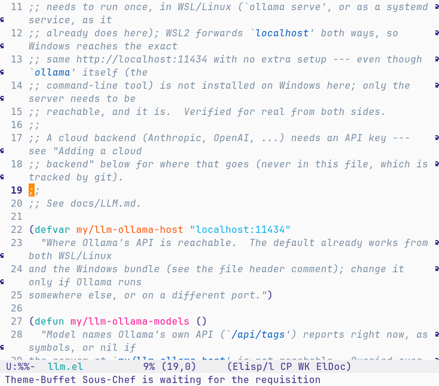
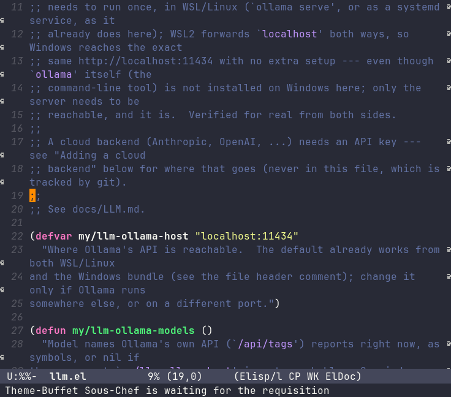
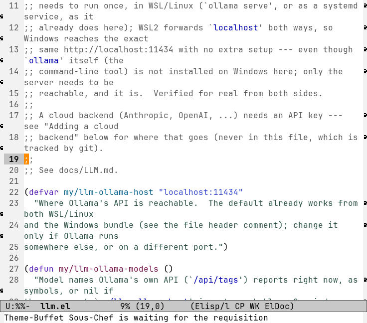
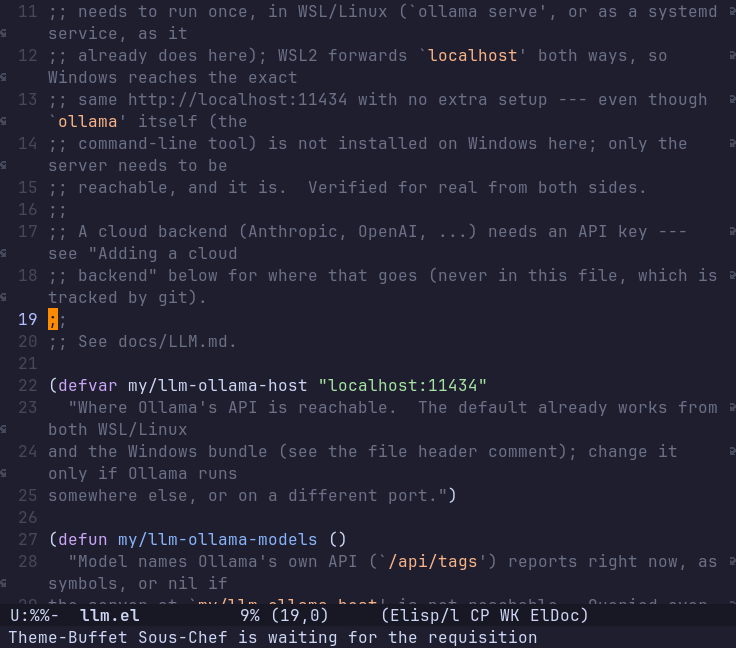

# My notes

A personal, running log of real commands and gotchas, kept short for quick reference and
printing --- not the polished general guides ([KEYBOARD.md](KEYBOARD.md) etc.), just
commands and one-line notes, added to as they come up.

## Opening Emacs

| Command | What it opens |
|---|---|
| `install/bin/emacs --init-directory=$PWD/config` | this repo, Linux/WSL, the normal pruned install |
| `build/src/emacs --init-directory=$PWD/config` | this repo, straight from the build tree, unpruned |
| double-click `Emacs.exe` inside the unzipped folder | the portable Windows bundle |
| `./Emacs` inside the unzipped folder | the portable Linux bundle |

`--init-directory=` is what makes it *this* config; without it, Emacs falls back to its own stock default.

## Current location, always shown at the top

| Topic | Note |
|---|---|
| What | every buffer's own header line (top of the window, not the mode line at the bottom) shows the full path of the file being edited, or the directory for one that isn't (Dired, `*scratch*`, ...) --- `~`-abbreviated the same way the minibuffer already shortens the home directory |
| Why there, not the mode line | the mode line (bottom) already shows the bare buffer NAME; this adds the one thing it doesn't, without duplicating it |
| `ranger` | untouched --- it already sets its own, more detailed header (`user@host : /path`), confirmed directly in its source; `setq-default` only ever applies to a buffer that hasn't set its own |

## Custom menu

| Topic | Note |
|---|---|
| Where | a real "Custom" entry in the menu bar itself, one submenu per topic (Finding files, Searching, Git (Magit), Project tree, Recent work, LLM chat, Themes, Help, ...) --- every command this config adds, clickable, not just a keyboard reference |
| Opening it without a mouse | `F10` (`menu-bar-open`, the real dropdown) or `M-\`` (`tmm-menubar`, a text-mode version that works in a plain terminal/`-nw` session too --- type the highlighted letter to drill down, same letters shown in `c==>Custom` style) |
| How it's built | generated directly from `my/shortcuts-list` (`config/shortcuts.el`), the exact same data `C-c k` and its tests already keep accurate --- not a second, separately hand-written copy, specifically to avoid repeating the reference panel's own real `F`-is-undefined mistake from earlier this session |
| Keybindings shown in the menu | real, live, straight from the actual keymap (e.g. "Git status... `C-x g`") --- never typed in by hand, so they can't go stale either |

## Exiting Emacs

| Command | What it does |
|---|---|
| `C-x C-c` | quit Emacs entirely (asks to save any unsaved files first) |
| `q` (in Magit/Treemacs/Dired/ibuffer/start screen/docs/shortcuts buffers) | closes just that buffer/window, not Emacs |
| `C-x 5 0` | close just the current frame (OS window) |

## Opening/closing the browsing buffers

| Open | Close | What |
|---|---|---|
| `C-x d` / `C-x C-j` | `q` | Dired |
| `C-c t` / `C-c T` | `q` (hide) / `Q` (reset) | Treemacs |
| `C-c h` | `q` | Start screen --- recent files/folders/projects |
| `C-c f p` | `q` | Git repos list |
| `C-x g` (also `C-c g`) | `q` (`C-u q` kills it) | Magit status |
| `C-c a a` | `C-x k` | LLM chat (gptel) |
| `C-c a c` | `q` | LLM council |
| `C-c n` | `q` | News (newsticker) |
| `C-c d` (`C-c D` rebuilds) | `q` | Docs buffer |
| `C-c k` | `q` | Shortcuts buffer |
| `C-c w l` | `q` | Session list |
| `C-c w L` | `q` | Named sessions list |
| `C-c y` | `q` | Year calendar |
| `C-c m` | `C-c m` again | Dictation |
| `C-c M` | `C-c M` again | Live dictation |
| `C-c v` | `C-c v` again | Evil, vi keys |

## Ways to open a file, by scope (find files)

| Scope | Command | Method | Source |
|---|---|---|---|
| Folder | `C-x C-f` | built-in completion, current directory | Built-in |
| Folder | `C-x d`/`C-x C-j` then `RET` | Dired browse | Built-in |
| Folder | `C-c t` then `RET` | Treemacs browse | Package (Treemacs) |
| Folder | `C-c f d` | fuzzy, live only, current dir subtree | **Custom** |
| Project | `C-c f f` | fuzzy, cached index + live fallback | **Custom** |
| Project | `C-x p f` | built-in completion, not fuzzy; follows current buffer's project, same as `C-c f f` | Built-in |
| Project | `C-x p d` | Dired on project root | Built-in |
| Project | `C-c s f` (`consult-fd`) | literal/regexp, `fd`, no live preview | Package (Consult) |
| Disk | `C-c f g` | fuzzy, cached whole-disk index + live fallback | **Custom** |
| Disk | `C-c f a` | same, async (Consult/fd), never blocks | **Custom** (wraps `consult-fd`) |
| History | `C-c h` then `RET`/number | recent list, no query typed | **Custom** |

`gmtry` finds `Geometry.java` via the fuzzy commands (`f f`/`f g`/`f d`), not via `C-x p f`/`C-c s f`.

## Searching text, by scope (Consult + built-ins compared)

| Scope | Command | Match type | Live preview | Source |
|---|---|---|---|---|
| This buffer | `C-s`/`C-r` | simple (`M-r`→regexp) | yes | Built-in |
| This buffer | `C-M-s`/`C-M-r` | regexp | yes | Built-in |
| This buffer | `C-c s l` (`consult-line`) | completion-style | yes | Package (Consult) |
| This buffer | `M-s o` (`occur`) | regexp | no | Built-in |
| This buffer | `M-%`/`C-M-%` | simple/regexp | no (steps, asks y/n) | Built-in |
| Directory (ask) | `C-u C-c s g` | ripgrep literal/regexp | yes | Package (Consult) |
| Directory (ask) | `C-u C-x p g` | regexp | no | Built-in |
| Project | `C-c s g` (`consult-ripgrep`) | ripgrep literal/regexp | yes | Package (Consult) |
| Project | `C-x p g` | regexp | no | Built-in |
| Multiple buffers | `M-x consult-line-multi` | completion-style | yes | Package (Consult) |
| Multiple buffers | `M-x multi-occur` | regexp | no | Built-in |

- No dedicated key for directory-scoped text search --- `C-u` in front of the project-search commands prompts for a directory instead.

## LLM

| Command | Note |
|---|---|
| `C-c a a` | Ollama auto-setup via its `/api/tags` HTTP endpoint directly, no `ollama` CLI needed |
| `C-c a m` | switch model/backend/prompt; ChatGPT/Claude/Gemini pre-registered but inactive until a key is in `~/.authinfo.gpg` |
| `C-c a c` | 3 small local models in parallel + 1 separate bigger summarizer, never the largest model pulled |

## Dictation

| Command | Note |
|---|---|
| `C-c m` / `C-c M` | fully local (whisper.cpp), no cloud, no API key |
| Linux stop | `SIGTERM` + wait --- `delete-process` alone corrupts the WAV header |
| Windows stop | sends `"q"` on stdin --- no `SIGTERM` equivalent on Windows |

## Session

| Topic | Note |
|---|---|
| `emacs-session.el` name | avoids a real collision with a third-party `session` package Org expects |
| `auto-save-visited-mode` | saves an unlocked (`C-c e e`), edited buffer back to disk a few seconds after you stop typing |
| What actually gets saved | window placement, buffers, files and frame chrome (menu bar/tool bar/decorations) all persist on their own, via `desktop-save-mode`'s own "frameset" mechanism --- confirmed directly by inspecting a real saved file, not assumed from the name "session" |
| The color theme | did NOT persist on its own (`theme-buffet` always re-picked a fresh random one at every startup regardless) --- fixed with `my/session-theme`, saved/restored via `desktop-globals-to-save` + `desktop-save-hook`/`desktop-after-read-hook`, timed to run after `theme-buffet`'s own startup pick so it correctly wins |
| `C-c w r` (`my/session-reset`) | only deletes the *saved* file --- it does **not** touch your currently running Emacs's frame/theme at all. If menu-bar/theme/etc. are wrong in the live session when you run this, they'll just get auto-saved wrong again on the very next exit. Fix the live state first (or use `C-c U`, which does both at once), then reset/save |

## Which-key

| Topic | Note |
|---|---|
| `*` in Dired | a real prefix key (the mark submenu) --- good way to see the popup: open Dired, press `*`, wait a second |
| Popup side | stock bottom, everywhere, no exceptions --- tried moving it to the right (globally, then scoped to just Dired/Org) across two earlier attempts this session, reverted both times; the right side in Dired/Org is now used by `C-o`'s Casual menu and the always-visible reference panel instead (below) |

## Dired and Org: Casual (`C-o`) and the always-visible reference panel

Two deliberately different things --- worth keeping straight:

| Topic | Note |
|---|---|
| `C-o` (Casual) | a real, Magit-style **transient** popup --- modal, takes over the keyboard, closes the instant you pick one action. `casual-dired-tmenu` in Dired (grouped File/Directory/Bulk/Navigation/Quick/Search/New), `casual-org-tmenu` in Org (grouped Headline/Date/Priority/Link/Timestamp/Mark/etc., context-aware --- shows the actual heading text at point). Dired/Org only --- `ranger`/Treemacs have no Casual integration |
| The reference panel | the opposite --- a plain, read-only, **non-modal** sidebar (`my/mode-reference-mode`, `config/mode-reference.el`), always visible the moment you're in a real Dired, Org, `ranger', or Treemacs buffer, never grabs focus, never closes on its own mid-task. A real bug, found by actually using it (`F` for "new file" said "F is undefined"): the first version of this content was transcribed from Casual's own `C-o` menu *labels*, which mostly only mean anything while that menu has focus, not as real standalone keys --- turned up to be systematic, not a one-off, across both original panels. Rebuilt with every single entry re-verified directly against the real `dired-mode-map`/`org-mode-map` instead, with `tests/ert/mode-reference.el` now parsing and checking every key automatically so this can't silently come back |
| Extended to `ranger`/Treemacs | user request, after the panel had already proven itself for Dired/Org --- `ranger''s own entries went through the same discipline (every key individually `lookup-key'-checked, not guessed), and Treemacs's text reuses the already-verified table from `docs/TREEMACS.md' directly (including this config's own `D'/`z'/`G' cross-navigation commands). `ranger-mode' is checked BEFORE `dired-mode' in `my/mode-reference--relevant-mode' --- confirmed directly, `ranger-mode' IS `dired-mode' underneath, so checking order matters or it would show Dired's text in a `ranger' session |
| `ranger`'s own window-slot conflict, found again | `ranger''s own preview pane (confirmed directly in its source) uses the exact same `(side . right) (slot . 1)' the panel already used --- the identical failure mode Casual's menu hit against the panel earlier (see below), just a second real instance of it. Fixed with `my/mode-reference--slot-for': `ranger' gets slot 2, a genuinely different one, so all 4 panes (parent, listing, preview, reference) now coexist; switching INTO or OUT OF `ranger' deletes and recreates the panel's window in the right slot, since a side window's slot can't be changed after it's created |
| `ranger`'s own panel is narrower | its own three panes already fill the frame (see "A ranger-style file manager" above) --- the panel uses 0.16 width there instead of the usual 0.28, confirmed visually to still read comfortably in a real terminal session |
| Package (Casual) | `casual` (github.com/kickingvegas/casual), verified directly against MELPA, not assumed --- a big umbrella package (109 files), covers other built-in modes too (re-builder, timezone, etc.), only the Dired and Org parts are wired up here |
| The Dired `C-o` collision | was already `dired-display-file` (show in another window, don't switch) --- kept Casual on `C-o` anyway, matching its own documented cross-mode convention; `o`/`v` already cover similar ground, `M-x dired-display-file` still works directly. Org had no existing `C-o` binding of its own, confirmed directly, so no collision there |
| First use is slower | loading (and likely natively compiling, like any installed package's first real use) `casual-dired`/`casual-org` the first time `C-o` is pressed in a session takes a few real seconds, confirmed directly (not instant) --- every use after that in the same session is fast |
| The real window-slot conflict | both the panel and Casual's menu wanted the exact same right-side window --- found by testing: the second one to try displaying silently failed to show at all, while its modal keymap still captured every keystroke (very confusing until tracked down). Fixed by giving them distinct `slot` values on the same `(side . right)` edge (panel: slot 1, Casual: slot 0) --- they now genuinely coexist, stacked, Casual's menu appearing above the panel when `C-o` is pressed while it's already showing |
| Auto show/hide | `dired-mode-hook`/`org-mode-hook` (covers the very first buffer at startup) plus `window-selection-change-functions`/`window-buffer-change-functions` (covers every later switch) --- a real gap found by testing: the window-change hooks alone never fire for the first buffer shown at startup, since there is no prior session state to have "changed" from |
| Scrolled away from its own top | a real, user-reported bug: `C-c U` (menu-bar/tool-bar toggled, a real frame-geometry change in a GUI) could leave the panel scrolled a little way down, cutting the first few lines off --- `window-start` was only ever set once, when the window was first created, never re-asserted after a resize. Fixed with `window-size-change-functions` (catches any resize generally) and `my/reset-to-defaults` explicitly re-anchoring it too (catches this specific trigger directly) |

## Org mode

| Topic | Note |
|---|---|
| `.org` auto-activation | back on (was disabled for one session, then re-enabled on request) --- `.org` files open in real `org-mode` again |
| Its ~103 `C-c` bindings | confirmed mode-local, not global: a plain buffer sees 25 `C-c` bindings (this config's own), a real org buffer sees 109 --- they never show up in any other file type |

## Year calendar

| Command | Note |
|---|---|
| `C-c y` | real 12-month grid (4 rows x 3) --- stock `M-x calendar` only ever lays out one wide row |
| `*Year Calendar*` buffer | separate from the real `*Calendar*`, doesn't touch `calendar-total-months` |

## News

| Topic | Note |
|---|---|
| `C-c n` | built into Emacs (`net/newsticker.el`), no package |
| Fetching | `url-retrieve`, no external `wget`/`curl` --- works on the Windows bundle too |
| Feeds | 10 curl-verified live feeds, one per category |
| Loading | nothing fetches until `C-c n` is actually pressed |

## Themes

| Command | Note |
|---|---|
| `C-c c` *char* | pick a color theme by character --- `1`-`9`, then `a`-`z`, then `A`-`T` (55 themes total), `0` for the default (Emacs's own plain look) --- never stacks (previous theme disabled first) |
| `C-c .` / `C-c ,` | switch to the next/previous theme in the list, whatever character it's bound to --- for when the specific slot doesn't matter, wraps around at either end |
| `C-c C` | `consult-theme` --- fuzzy-search any installed theme *by name* with a live preview, including every `doom-themes` variant (see below), instead of memorizing a character |
| `M`-`T` | Modus Themes, light then dark: operandi / tinted / deuteranopia / tritanopia / vivendi / tinted / deuteranopia / tritanopia |
| (automatic) | `theme-buffet` still only rotates the 8 Modus Themes light/dark by time of day, re-checked hourly --- `C-c c`/`C-c .`/`C-c C` always override it; none of the other 47 themes were added to its rotation |

The full `C-c c` character -> theme mapping, grouped by package (also in `my/themes` in
`config/init.el`, the single source of truth --- this table is just a friendlier view
of the same thing):

| Key | Theme | | Key | Theme |
|---|---|---|---|---|
| `1` | atom-one-dark | | `2` | catppuccin (mocha) |
| `3` | solo-jazz | | `4` | nimbus |
| `5` | rebecca | | `6` | subatomic |
| `7` | night-owl | | `8` | seti |
| `b` | snazzy | | `c` | horizon |
| `h` | zenburn | | `u` | dracula |

**shanty-themes:** `9` dark, `a` light
**xcode-theme:** `d` dark, `e` light
**immaterial-theme:** `f` dark, `g` light
**ember-theme** (manual-only, needs `doom-themes`): `K` light, `L` soft

**solarized-theme** (12): `i` dark, `j` light, `k` dark-high-contrast, `l`
light-high-contrast, `m` gruvbox-dark, `n` gruvbox-light, `o` selenized-black, `p`
selenized-dark, `q` selenized-light, `r` selenized-white, `s` wombat-dark, `t` zenburn

**kaolin-themes** (15): `v` dark, `w` light, `x` aurora, `y` blossom, `z` breeze, `A`
bubblegum, `B` eclipse, `C` galaxy, `D` mono-dark, `E` mono-light, `F` ocean, `G` shiva,
`H` temple, `I` valley-dark, `J` valley-light

**Modus Themes** (8, built-in): `M` operandi, `N` operandi-tinted, `O`
operandi-deuteranopia, `P` operandi-tritanopia, `Q` vivendi, `R` vivendi-tinted, `S`
vivendi-deuteranopia, `T` vivendi-tritanopia

Plus `0` for the default (no theme). `doom-themes`'s own 50+ variants aren't on this
list at all --- reach those through `C-c C`'s fuzzy search by name instead.

All 8 [Modus Themes](https://github.com/protesilaos/modus-themes) ship built into Emacs 28+ already --- no package, confirmed directly (`etc/themes/modus-*-theme.el`). The other 47 come from 15 separately installed packages (`atom-one-dark-theme`, `catppuccin-theme`, `solo-jazz-theme`, `nimbus-theme`, `rebecca-theme`, `subatomic-theme`, `night-owl-theme`, `seti-theme`, `shanty-themes`, `snazzy-theme`, `horizon-theme`, `xcode-theme`, `immaterial-theme`, `zenburn-theme`, `solarized-theme`, `dracula-theme`, `kaolin-themes`, `ember-theme` --- full URLs in the WHAT/WHY comment above `my/themes` in `config/init.el`). A real, easy-to-get-backwards gotcha found while wiring these up: `load-theme` never consults `load-path` at all --- it always does its own file search through `custom-theme-load-path`, whose `t` entry expands to Emacs's *built-in* `etc/themes` directory, not to `load-path`; a theme package can `require` fine while still being completely invisible to `load-theme`/`consult-theme` unless its directory is *also* pushed onto `custom-theme-load-path` (now done in the same loop that adds `config/elpa`'s subdirectories to `load-path`). `my/themes` in `config/init.el` is the character→theme mapping; add more there (any installed theme) to extend `C-c c` without a new keybinding. `ember-theme` needs `doom-themes` as a hard dependency --- installed, but deliberately never `require`d automatically (this project's own `startup/no-third-party-features-loaded' test forbids it), so `doom-themes`'s own 50+ variants are reachable only via `C-c C`'s fuzzy search, never a `my/themes` slot. `theme-buffet` is a real GNU ELPA package (not one of Protesilaos's own, despite appearing in his dotfiles) --- `my/themes-light`/`my/themes-dark` is where it's told which of `my/themes`'s entries count as which; keep both lists in step when adding a theme that should also take part in the automatic rotation.

**The fixed cursor color, across 4 of the 55 themes** (real screenshots of this build,
same file and same line in every shot, so the only thing that changes is the theme):
`enable-theme-functions` keeps the cursor a fixed `DarkOrange` no matter which theme is
active, since several themes don't give it enough contrast against their own `hl-line`
color on their own.

*`solo-jazz` (light) --- the theme the regression test itself uses, since this was visibly wrong here before the fix:*

*`dracula` (dark):*

*`modus-operandi` (the built-in, accessible light theme):*

*`catppuccin` (mocha):*

## Magit

| Topic | Note |
|---|---|
| "pathspec '...' did not match" | git has no such branch/tag, not a Magit bug --- `b b` to pick an existing one, `b c` to create a new one |
| Transient switches | keys literally include a `-` (e.g. `-n`, `-A`) --- press `-` then the letter |
| `magit-dispatch` (`C-c G`) | Magit's own full command menu (status, log, branch, stash, everything) --- was autoloaded in init.el from early on but never actually bound to a key until a real gap report ("also include magit in the menu") caught it |

## Six more packages (Corfu, Yasnippet, expand-region, diff-hl, vterm, pdf-tools)

| Topic | Note |
|---|---|
| Corfu (`C-c k`'s own popup, no key to press) | in-buffer completion as you type, driven by whatever `completion-at-point-functions` the buffer already has --- Eglot wires its own in per-buffer automatically, nothing extra to do |
| `corfu-terminal`/`popon` | tried, then deliberately left back OUT --- this project's Emacs (32.0.50) already has native tty-child-frame support, confirmed by actually watching a real popup render in a real `-nw` session; `corfu.el` itself warns `corfu-terminal` is unneeded on Emacs 31+ |
| `C-c Y` (`yas-insert-snippet`) | Yasnippet; no snippet collection is bundled on purpose, so this starts empty --- `M-x yas-new-snippet` to write one |
| TAB and Yasnippet | only ever intercepts TAB when the text right before the cursor is a real snippet trigger (a `:filter`'d conditional keybinding, Emacs's own standard idiom) --- any other TAB press behaves exactly as before |
| `C-=` / `C-M--` | expand-region: grow/shrink the selection by semantic units (word, then the content inside the nearest pair, then the pair with its parens, then outward again) |
| diff-hl | live git change markers --- a fringe `\|` in a GUI frame, a margin `+`/`-`/`~` in a `-nw` terminal session (`diff-hl-margin-mode`, needed since the fringe doesn't exist there at all); also marks changed files in Dired itself |
| `C-c V` (`vterm`) | a real terminal emulator (full curses apps: htop, vim, ssh) --- its native module downloads and builds its own copy of `libvterm` automatically the first time it's used. True on Linux (this machine already had `cmake`/`gcc`); on a fresh Windows machine those genuinely need installing first --- see the Windows row below |
| `vterm` on Windows | needs `cmake` and a real C compiler present on THAT machine before `C-c V`'s first-use compile can work --- confirmed for real: `cmake` was already there on one test machine, `gcc`/`g++` were not, installed via `winget install --id BrechtSanders.WinLibs.POSIX.UCRT` (a maintained MinGW-w64 build; confirmed working from a fresh shell afterward --- a shell already open when the install runs will not see the updated PATH, needs a new one). A real, found-while-testing-this gotcha if you try to verify the compile indirectly (e.g. driving a Windows Emacs process from WSL): the compiled module can end up named/built wrong (an actual Linux ELF file, not a Windows DLL) if the process spawning `cmake`/`gcc` has a stale or cross-contaminated `PATH` --- a real, normal, directly-launched Windows Emacs session (double-click, or a real Windows terminal) does not have this problem; only indirect/bridged invocations do |
| pdf-tools | wired in, but genuinely blocked on one real system package this build process cannot install for itself: `sudo apt-get install libpoppler-glib-dev`, then restart Emacs --- until then, `.pdf` files keep working exactly as before (no regression either way, see init.el's own comment) |

## A ranger-style file manager (`C-c R`), genuinely separate from Dired

| Topic | Note |
|---|---|
| `C-c R` (`ranger`) | opens a real Miller-columns file manager (parent dir, listing, live preview) --- explicitly kept separate from plain Dired, per a real user request, not a default |
| Why `ranger`, not `dirvish` | `dirvish` (tried first) only works at all with its own GLOBAL `dirvish-override-dired-mode` turned on, which would make plain `dired`/`C-x d` ALSO become Dirvish sessions --- confirmed directly by calling its standalone `dirvish` command without that mode on and getting a perfectly plain Dired buffer back, nothing Dirvish-specific at all; `ranger-mode` is a real, self-contained derived mode instead, no global switch needed |
| Two real "mingling" bugs found and fixed before this shipped | (1) the always-visible reference panel (built earlier this session) would claim the exact side-window slot ranger's own preview pane needs, breaking its layout --- fixed with a dedicated slot/width for `ranger-mode` (see "Dired and Org: Casual" above, now showing ranger's own content there too, not excluded any more); (2) `ranger.el` itself installs `C-p` → `deer-from-dired` into the SHARED `dired-mode-map` (its own default `ranger-key`) the first time ANY Dired buffer opens after it's loaded, silently breaking plain `previous-line` in Dired everywhere --- fixed by pre-setting `ranger-key` to nil in init.el before the library ever loads |
| Opening a file leaves ranger's own keys behind | real user confusion, worth knowing: pressing `l`/`RET`/right-arrow on a FILE (not a directory) calls `find-file` on it, which replaces that window's buffer with the file's own major mode --- `ranger-mode-map`'s own keys (`h`/`j`/`k`/`l`, arrows, etc.) stop working at that point, since you're no longer in a `ranger` buffer at all. `C-c R` is bound GLOBALLY, not just inside `ranger` --- pressing it again from the opened file re-opens `ranger` right where you were (it defaults to the current buffer's own directory), the simplest way back |
| Pane widths | the default 3-pane split (`ranger-width-parents` 0.12, `ranger-width-preview` 0.65) left the middle pane --- the one you're actually reading --- squeezed into just 23% of the frame, well left of center. A first rebalance (0.15/0.50, parent 15%/middle 35%/preview 50%) widened it but, confirmed with a real screenshot, still centered it at only ~32% --- giving the preview pane the single biggest share always pushes everything else left of true center, however the middle pane's own width is tuned. Settled on 0.25/0.25 (parent 25%/middle 50%/preview 25%), the one ratio that puts the middle pane's own midpoint EXACTLY at the frame's center (`0.25 + 0.50/2 = 0.5`), confirmed visually --- the real tradeoff, the user's own explicit choice: a visibly smaller preview pane than ranger's own default convention favors, offered directly rather than assumed |
| Does this depend on screen size/resolution? | No --- confirmed directly in `ranger.el''s own source (`(floor (* (frame-pixel-width) ranger-width-preview))`): these are FRACTIONS of the current frame's own pixel width, computed fresh every time the layout is built, not fixed pixel counts, so the same 25/50/25 ratio holds identically on any monitor, window size, or resolution |

## Dired / ranger / Treemacs / Magit: cross-navigation

Jump between all three file browsers (and Magit) without losing the directory you're
currently in, user-requested one route at a time until the whole matrix was covered.
Every key here is LOCAL to that one mode's own keymap (`r` means something different
in Dired than in `ranger`, etc.), never a shared global one --- exactly to avoid
repeating the real `C-p' mingling bug above.

| From | Key | Goes to |
|---|---|---|
| Dired | `r` | `ranger`, same directory |
| `ranger` | `r` | plain Dired, same directory (and cleans up `ranger`'s own extra parent/preview panes, which its own `ranger-to-dired` deliberately leaves open) |
| Dired or `ranger` | `C-c T` | Treemacs, on that directory --- a real gap fixed along the way: `treemacs-find-file` (what `C-c T` wraps) only ever looks at `buffer-file-name`, always nil in a directory listing, so this used to fall into Treemacs's own "File to find:" prompt instead |
| Treemacs | `D` | plain Dired, on the directory at point |
| Treemacs | `z` | `ranger`, on the directory at point |
| Treemacs | `G` | Magit status for the repository the directory at point belongs to --- a real gotcha: `magit-status` called WITH a directory argument requires that EXACT directory to be a repo's own toplevel, or it offers to init a nested repo there instead, so this `let`-binds `default-directory` and calls it with no argument instead, the same way `C-x g` itself does |
| Dired or `ranger` | `C-x g` | Magit status for the enclosing repository --- already worked, no new binding needed, confirmed directly (`key-binding` from inside each) |

## Dist bundles / GitHub Actions

| Topic | Note |
|---|---|
| Fresh unzipped bundle | no `recentf`/`recents` history shipped --- always starts clean |
| `.github/workflows/release.yml` | Linux only (Windows dist needs WSL/`cmd.exe`) --- triggers on a pushed version tag (`v*`) |

## Reference panel toggle, Docker/Kubernetes, and a batch of smaller tools

| Topic | Note |
|---|---|
| `C-c H` | turns the always-visible reference panel (Dired/Org/ranger/Treemacs) off, or back on --- shown by default |
| `C-c K d` | Docker: one transient menu for containers/images/volumes/networks (needs a real `docker` on PATH) |
| `C-c K k` | Kubernetes: `kubernetes-overview`, a buffer listing a cluster's resources (needs `kubectl` configured) |
| `C->` / `C-<` / `C-c C-<` | multiple-cursors: mark next/previous/all occurrences like this, then just type |
| `C-c C-h` (inside an Org buffer with `verb-mode` on) | `verb`, a real HTTP client --- "postman in eMacs." `C-c C-h C-s` sends the request at point |
| `C-h D` | `devdocs-lookup` --- offline language/library docs, each set downloaded on first use |
| `C-c v` (Evil toggle) | now also offers to install/initialize `evil-collection` the first time Evil turns on --- real vi keys in Dired/Magit/Treemacs/etc., not just plain Emacs's own bindings under Evil's normal state |
| `vterm` on Windows | genuinely does NOT work, full stop --- not a missing-tool problem, confirmed by reading `vterm-module.c` itself: it unconditionally uses real POSIX `termios`/pty calls with zero Windows code path anywhere. `libtool`/`cc`/libvterm's own Unix-only `bin/` tools were all real, fixable gaps found first (MSYS2 for `libtool`, copy `gcc.exe` to `cc.exe`, and vterm's `CMakeLists.txt` now asks for just the `libvterm.la` target) --- but the module itself still can't build. `C-c V` stays Linux-only |
| `C-c W` | a WizTree-style disk usage browser (`my/disk-usage`, powered by `dua` --- real, parallel, fast, but NOT WizTree's own MFT-reading trick; ~2 minutes for a full ~1.3 TB Windows `C:\`, confirmed for real) --- `RET`/`f` drills in, `^`/`u` goes back up, `d` opens Dired there |
| `C-c W` inside Dired | a different thing, same key: toggles `dired-du-mode` --- recursive sizes right in the listing. Off by default, noticeably slower on a big tree |
| This config's own package-activation gap | bit twice now (`docker`/`kubernetes`, then `dired-du`): `package.el` is only ever used to DOWNLOAD packages here, never to activate them --- every single optional command needs its own explicit `(autoload ...)` in `init.el`, or it is just plain not `fboundp` at all, confirmed the hard way both times by `tests/ert/keybindings.el`'s own `keys/every-documented-command-exists` |
| `C-c F`/`C-c }`/`C-c {` | pick/cycle a font by character, 20 real ones (`my/fonts`) --- same shape as `C-c c` for themes, but a font is a plain OS resource this project never installs, so picking one not actually on the machine says so plainly instead of silently doing nothing |
| `:font` vs `:family` on `set-face-attribute` | a real, found-the-hard-way difference: `:font` takes a full font STRING and silently does NOTHING at all if it cannot resolve a real matching font right then (no error, face stays whatever it was); `:family` sets the plain family-name attribute unconditionally. Use `:family` for anything that needs to reliably apply/be testable; `:font` is fine only when already gated behind a real `find-font' check first (see the font-switcher above) |
| Dual line-number columns (`my/absolute-line-numbers-margin-mode`, GUI only) | `display-line-numbers-type` is `relative` (one line, real request after it showed up in another Emacs user's own config); the CURRENT line still shows its real absolute number for free (`display-line-numbers-current-absolute`, a real built-in, on by default) --- but showing absolute for EVERY line at once needed a second, hand-built column: a left window MARGIN with overlays, since `display-line-numbers-mode` only ever draws one number per line natively, no Lisp hook for a second. GUI-only (`diff-hl-margin-mode` only ever uses a margin as a *terminal* fallback, confirmed in its own code, so no real conflict to worry about there) |
| A real hang, found testing the margin feature above | `window-end`/`forward-line` can desync at a buffer's own edges (no trailing newline, an empty buffer) and loop forever in a function that runs on every keystroke --- confirmed directly: an actual Emacs process stuck past the 15s timeout in the real GUI screenshot pipeline. Fixed with a hard iteration cap (no real window is ever hundreds of lines tall) and by computing `window-end` ONCE before the loop, not on every iteration (repeatedly forcing it can itself trigger redisplay) |
| `%p` in the mode line (buffer position as a percentage, or Top/Bot/All) | a real, built-in Emacs feature, just off by default --- `(size-indication-mode 1)` is the one line that turns it on; `mode-line-percent-position` already holds the right format spec either way |

## Keybindings copied from another Emacs user's own dotfiles

Read every actual file that `.emacs` loads directly (fetched from its public GitHub repo,
not just skimmed), then ported the bindings that were real, free, and generically useful here ---
not the whole file verbatim.

| Topic | Note |
|---|---|
| `C-,` / `C-c M-q` / `C-x C-g` | `my/duplicate-line`, `my/unfill-paragraph` (the inverse of `M-q`), `find-file-at-point` (built in) --- that config's own `.emacs.rc/misc-rc.el`, ported key-for-key since all three keys were confirmed free first |
| `C-c C-j` (Emacs Lisp buffers only) | `eval-print-last-sexp` --- its own `emacs-lisp-mode-hook` local binding; cannot clash globally since it is mode-local, the same way `lisp-interaction-mode` already binds plain `C-j` to this by default |
| `C-S-c C-S-c` / `C-"` / `C-:` | the rest of `multiple-cursors`'s own convention that config also uses (`mc/edit-lines`, `mc/skip-to-next-like-this`, `mc/skip-to-previous-like-this`) --- added alongside the `C->`/`C-<`/`C-c C-<` already here |
| `M-p` / `M-n` | `move-text-up`/`move-text-down`, a new package (`move-text`, MELPA) --- shift the current line/selection up or down bodily |
| A real menu-building gotcha, found while adding these | `my/custom-menu--spec' keys each Custom-menu item by `(intern DESC)` --- the third element of a `my/shortcuts-list` row, not the key or command --- so two rows in the SAME topic with an identical description string silently collide in the generated keymap (`mc/skip-to-previous-like-this` had copy-pasted "the same, backwards" from `mc/mark-previous-like-this` right above it; `tests/ert/shortcuts.el`'s `custom-menu-items-run-the-real-commands` caught it immediately). Every description in a topic must be unique, not just every key |
| Deliberately NOT copied | `M-x` -> `smex` (this config's Vertico/Orderless already covers it, better); that config's `C-c m s`/`C-c m l` (Magit log/status; `C-c m` is already dictation here, and both are already reachable via `C-x g`/`C-c G`); its whole Helm block (`C-c h` is already `my/start`; Vertico/Consult already cover the same ground); `C-x a` (org-agenda; `C-x a` is stock Emacs's own `abbrev-map` here) and `C-c i m` (imenu; already bound at the stock `M-g i`); `C-c c` (org-capture; already the theme picker here); its whole org-cliplink/agenda-folder workflow (`C-c C-x j`, `C-x p w`/`i`/`t`) --- tied to its own personal agenda folder, not a generic binding this config has any use for |

## `tools/cloudmacs.sh` --- this actual Emacs, in a browser tab

| Topic | Note |
|---|---|
| `tools/cloudmacs.sh [PORT]` | Gotty (`sorenisanerd/gotty`, a verified-checksum download cached in `dist/cache/`) serving `emacsclient --tty -c` against a real `install/bin/emacs --init-directory=config --daemon` --- this project's own config, in a browser, local machine only (`127.0.0.1`, no auth). Full writeup: `docs/CLOUDMACS.md` |
| Why not the real `karlicoss/cloudmacs` Docker image | Its own Dockerfile is built on `silex/emacs:master-alpine` --- musl libc. This project's native-compiled `.eln` files are glibc-linked (built on Ubuntu) and will not load under musl --- the same "machine-specific native-build artifact" problem `tests/test_dist.py` already guards the dist zips against, in a new place. Running Gotty directly against this host's own already-built Emacs sidesteps it entirely, no Docker needed |
| Real gotcha fixed while writing the script | The gotty release tarball's own entry is `./gotty`, not `gotty` --- `tar -xzf ... gotty` silently fails to find it ("Not found in archive"); fixed by extracting `./gotty` instead |
| Ymacs (`mishoo/ymacs`, cloned as a SEPARATE sibling project at `../ymacs`, not part of this repo) | A real, actively-maintained JS-only Emacs-LIKE code editor for the browser --- zero elisp, shares NOTHING with this project's own config. `npx parcel build` first (its `demo/` CSS imports the built `dist/ymacs.css`/`dist/themes/*.css`, not raw `src/`), then `demo/run.sh [PORT]`. Its own `test/test.js` calls `cmd("load_file", "index.html")`, a real RPC to a backend this plain static setup does not have --- throws `Ymacs_Exception` and never gets past the loading screen; worked around with a separate `demo/demo.js` using `Ymacs_Buffer.setCode()` directly instead, which needs no backend |

## `C-c F` said "not found" on a fresh install --- 12 of the 20 fonts now actually bundled

Real gap the user hit on a brand-new Windows PC: the 15 font files installed on THIS dev
machine's own `~/.local/share/fonts/` (the font-switcher batch, above) never shipped
anywhere --- `C-c F` correctly, honestly said "not installed" for every one of them on a
machine that never had them. Fixed by actually bundling 12 of the 20 (`tools/fonts/`, ~1.6 MB
total, real files plus their real OFL/UFL license texts fetched from `github.com/google/
fonts`) into both dist zips, with a one-time "select all, right-click, Install" step (no admin
needed) --- `tools/fonts/README.md`/`docs/DISTRIBUTION.md` spell it out. Iosevka (~114 MB for
both weights) and 3 never-downloaded fonts (Hack, Monaspace Neon, Commit Mono) deliberately
left out, a real size/effort tradeoff, not an oversight --- documented plainly rather than
silently incomplete. `C-c F` itself needed no code change: it was always correctly checking
`find-font`, the files just were not there to find.

## The other 8 fonts, bundled too (`bundle-all-fonts` branch) --- all 20 now real files

User asked for the Windows zip to need zero installs/downloads of any kind, after first
asking (and being talked out of, once the tradeoff was clear) a full bundled JDK + Rust
toolchain for Java/Rust language-server support they don't actually use. With those off the
table, the only real remaining gap was these last 8 fonts, so all 8 were fetched for real
(not assumed) and bundled:

| Font | Real gotcha |
|---|---|
| `JetBrainsMono Nerd Font Mono` | Nerd Fonts patches ONE source font into several DIFFERENT family names (`...Nerd Font`, `...Nerd Font Mono`, `...Nerd Font Propo`) in the same release tarball --- only the `Mono` one matches what `my/fonts` looks for; confirmed with `fc-scan`, not the filename |
| `CommitMono` | the real font file registers its family as `CommitMono`, no space --- `my/fonts` said `"Commit Mono"` (with a space) and would NEVER have matched even with the real file installed. This is a genuine pre-existing bug in `config/init.el`, not just a missing file; fixed alongside the bundling |
| `DejaVu Sans Mono`, `Hack` | NOT plain OFL, despite living next to a bunch of OFL fonts --- DejaVu is public domain + the Bitstream Vera license; Hack is MIT (Source Foundry's own part) plus the inherited Bitstream Vera/DejaVu licenses. Saved as `*-LICENSE.txt`/`.md`, not `*-OFL.txt`, so the filename does not overclaim |
| Iosevka's real size | the old estimate ("~114 MB for Regular+Bold") was based on an asset name (`ttc-iosevka`) that does not exist in current Iosevka releases any more. The current per-weight `.ttc` files are each already ~57 MB on their own (a single `.ttc` bundles upright/oblique/extended variants of that one weight together) --- bundling just `Iosevka-Regular.ttc` (confirmed via `fc-scan` to register plain `Iosevka`) was enough, no Bold needed, matching every other font here being one Regular file |
| Verification tooling | `fc-scan --format '%{family}\n' FILE` is what actually confirmed every family name below, not trust in the project's own README or filename --- `pip install fonttools` failed outright (PEP 668, externally-managed Python on this machine), so `fc-scan`/`fc-query` (already installed) did the job instead |

## `pdf-tools` on Windows, closed too (`bundle-all-fonts` branch) --- `epdfinfo.exe` bundled, zero install

The Linux gap (needs `sudo apt-get install libpoppler-glib-dev`, documented above) has no
`apt-get` equivalent on Windows at all, so it had stayed a real, permanent "install yourself"
item --- closed by bundling a real, prebuilt `epdfinfo.exe` instead of trying to build one.

| Topic | Note |
|---|---|
| Where `epdfinfo.exe` came from | MSYS2's own UCRT64 package, `mingw-w64-ucrt-x86_64-emacs-pdf-tools-server` --- the exact binary MSYS2 users get via `pacman -S`, fetched from `mirror.msys2.org` and checksum-verified against MSYS2's own `ucrt64.db` sync database |
| The real gotcha: MSYS2's declared package `Dependencies:` is the wrong source for "what DLLs does this binary need" | Following that field pulled in Python, Tcl/Tk, a full GnuTLS stack and more --- things the package as a WHOLE depends on (including CLI tools `epdfinfo.exe` never calls), not things `epdfinfo.exe` itself imports. Fixed by reading the real PE import table instead (`objdump -p`), recursively, stopping at genuine Windows system DLLs --- the correct closure is 53 DLLs, not the 100+ files the declared-dependency approach would have pulled in |
| Real verification | re-ran the same import-table walk against the files actually collected, confirmed every non-system import resolves locally; then started the real Windows Emacs (from WSL, same trick `tools/dist-windows.sh` already uses to compile packages), pointed `pdf-info-epdfinfo-program` at the bundled exe, and `pdf-info-check-epdfinfo` + `pdf-info-open` + `pdf-info-number-of-pages` all worked against a real hand-built PDF --- not just "the files exist," a real PDF actually got parsed |
| Licenses | all 41 packages' own license files, as MSYS2 ships them (`ucrt64/share/licenses/<pkg>/`), copied in --- except `libidn2` and `poppler`, which don't embed one in their MSYS2 package, fetched directly from each project's own upstream repo instead. Several are GPL (`poppler` itself, `jbigkit`, `emacs-pdf-tools-server`, `libgcc`/`libstdc++`/`gettext-runtime`) --- none of these binaries are modified from what MSYS2 publishes, and MSYS2's own build recipes plus each project's upstream source are both already public, same reasoning already applied to bundling MinGit. Full accounting: `tools/pdf-tools/README.md` |

## A real 9.3-million-line/93MB file was slow to scroll --- the real cause, and what actually fixed it

User asked for a genuinely huge test file (20 copies of a real English word list
concatenated, `words-20x.txt`) specifically to see whether this config's "lightning fast"
claim held up at real scale. It did not, at first: `C-n`/`C-p` near the end of the file had a
visible, real delay.

| Topic | Note |
|---|---|
| First suspect, real but NOT the actual cause | This config's own absolute-line-number margin (`my/absolute-line-numbers-margin-mode`) was rescanning from `point-min` via `line-number-at-pos` on every redraw --- genuinely slow, and genuinely fixed, with a tick-aware cache (`my/absolute-line-numbers--cache`) so a later redraw at the same `buffer-chars-modified-tick` counts the short distance from the last known (POS . LINE) via `count-lines` instead of rescanning the whole buffer. ~49x faster for that one function. Still not enough --- the delay was still there |
| The real cause, found by elimination, not guessed | `display-line-numbers-mode` itself --- native, C-implemented, not anything this config added --- measured directly as the actual bottleneck: plain `next-line` alone (no redisplay, no hook, nothing this config adds anywhere in its call path) took ~0.3s per call near the end of that file, dropping to instant the moment the mode was turned off. True for both `relative` and plain absolute numbering; `word-wrap` and the margin column above were checked and ruled out first. A real, surprising native Emacs limitation at this scale |
| The actual fix | `my/line-numbers-max-buffer-size` (5MB, `config/init.el`) + `my/line-numbers--maybe-disable-for-huge-buffer`, on `find-file-hook` --- turns BOTH `display-line-numbers-mode` and the margin mode off outright above that size. `buffer-size` is an O(1) character count, so the check itself costs nothing even on a huge file. Confirmed with real before/after numbers: 2.96s -> 0.000144s for 10 `next-line` calls near the end of the file |
| How the timing was actually measured | A real GUI frame (`--fg-daemon` + `emacsclient`), driving `execute-kbd-macro` + explicit `redisplay` calls --- a plain `--batch` invocation never exercises real redisplay, so timings there would have been meaningless. `profiler-start`/`-stop`/`-cpu-log` was tried first and gave empty/zero results even during a real, slow operation (confirmed NOT a real "zero CPU" by cross-checking `/proc/PID/status` showing `State: R` the whole time) --- a profiler methodology failure in this daemon/eval context, not a real finding; direct wall-clock `float-time` timing of isolated calls is what actually worked |

## Stress-testing that same file thoroughly (user request) --- three real issues, all three in the TEST TOOLING, not this config

Built `tools/stress-bigfile.sh` + `tests/stress/bigfile-bench.el` (on-demand only, by
explicit user request --- never run by `tests/run-all.sh`/regression, since a full pass needs
a real GUI frame and several real minutes) to drive real navigation AND real edits
(insert/delete/kill-yank/undo/a buffer-wide regexp count) against the real 9.3M-line file,
sustained over several minutes, specifically to check for hangs or degradation over time.
Final result: no hangs, flat timings across every round, RSS flat (no leak). Getting there
surfaced three real, worth-remembering issues --- two are pure test-tooling bugs with no
config change needed; one is a real, still-open scope question about the fix above.

| Topic | Note |
|---|---|
| Daemon hung on open, before any edit even happened | This config's crash-safe session persistence (`config/emacs-session.el`, `desktop-save-mode`) auto-restores previously open buffers at startup --- pointing a throwaway test daemon straight at the real `config/` dir reopened a STALE huge-file buffer left over from an earlier test run, hit the (still-default, at that point in startup) `large-file-warning-threshold' confirmation prompt, and sat there waiting for a keypress nothing could ever send it, which then blocks EVERY later `emacsclient` request to that same daemon (Emacs is single-threaded). Not a bug in real interactive use --- a real person just presses `y` once --- only a trap for scripting a daemon non-interactively. Fixed in the test script by giving the daemon its own isolated config copy with an emptied `session/` dir, never the real one. Real side effect while finding this: a couple of early debug runs DID write test buffers into the real, gitignored `config/session/.emacs.desktop` before the isolated-copy fix was in --- harmless (not tracked, not code), but the next real session's auto-restored buffers may look different than expected once |
| The 5MB auto-disable fix above did not apply to the test's own edit buffer | `my/line-numbers--maybe-disable-for-huge-buffer` is hooked ONLY to `find-file-hook` --- a huge buffer created any other way (this test's own in-memory copy of the file, or equally a real huge `*compilation*`/`*shell*`/`*grep*` output buffer) still gets `display-line-numbers-mode` turned back on via the global minor mode's own activation hook, with nothing left to turn it back off. Worked around in the test tool by disabling both features explicitly on its own throwaway buffer. Still an open, real question for the config itself: whether to broaden the fix to a buffer-size check independent of how the buffer was created, not yet decided |
| Measuring `undo` performance in a raw loop looked like a hang | Calling the interactive `undo` command repeatedly via plain `(dotimes (_ n) (undo))` is NOT the same as a real user pressing `C-u` repeatedly --- `undo` decides whether to continue the same undo session via `(eq last-command 'undo)`, which a bare Lisp loop never sets, so every single call calls `undo-start` again and reprocesses `buffer-undo-list` from its current head. Not technically infinite, but a real, practically-unbounded stall (confirmed: a 300-iteration version wedged a whole daemon for many minutes, with every later request to it queued behind it since Emacs is single-threaded). Fixed by calling `primitive-undo` directly instead, bounded and instant |
| Size | ~39 MB (`epdfinfo.exe` + 53 DLLs) |

## Encryption (`C-c x`), a password manager (`C-c p`), and clipboard history (`C-c C-y`/`M-y`)

User request: encrypt/decrypt files and folders (both a password and a real GPG key),
the standard Unix password manager, and "clipboard history" --- explicitly BOTH senses
of that phrase (a nicer kill-ring browser, and a genuinely separate system-wide
history), kept as two distinct commands by explicit request, not merged into one.
Full writeup: [docs/SECURITY.md](SECURITY.md). The real gotchas found building it:

| Topic | Note |
|---|---|
| EasyPG's own `epa-encrypt-file`/`epa-decrypt-file` can hang the WHOLE Emacs process | Their `epg`-based, agent-mediated passphrase protocol genuinely blocked indefinitely on a machine/session with no `gpg-agent` already running and no usable Pinentry reachable --- confirmed directly (no `gpg`/`pinentry` process was even left running; Emacs's own event loop just sat idle in `select()`). `epg-pinentry-mode' set to `'loopback'` helped but was not enough alone. Fixed by building `C-c x`/`C-c p` on plain `gpg --batch --passphrase-file ...` via `call-process` instead, which always returns immediately, succeeding or failing cleanly --- `--batch` is GnuPG's own guarantee it will never try to prompt interactively |
| `PASSWORD_STORE_DIR` was never actually set | This config's own `my/pass-store-dir` variable (used to check `.gpg-id`/list entries) was never passed to the real `pass` script via its own env var --- the two silently pointed at two different directories, so `pass` always used its real default (`~/.password-store`) no matter what `my/pass-store-dir` said. A real bug, not a test-only issue; fixed by deriving `PASSWORD_STORE_DIR` from `my/pass-store-dir` on every call |
| `call-process-region` with the SAME buffer as both its stdin input and stdout output | `my/pass-insert`'s first version did exactly that --- undefined, unsafe (a process reading its own not-yet-written output). Fixed with a separate output buffer |
| A `(when (display-graphic-p) ...)` guard around STARTING a timer, evaluated once at config-load time | For a `--fg-daemon`, no frame exists yet at that exact moment, so the timer would never start at all, even once a real GUI frame is attached moments later via `emacsclient -c` --- the same class of gotcha as the big-file stress test's own session-restore race, just in a new place. Fixed by starting the clipboard-history poller's timer unconditionally (gated only on not being a real `--batch` process) and checking `display-graphic-p` fresh on every tick instead |
| Reading a `*.gpg` file's content for a test assertion via plain `insert-file-contents` | `epa-file` registers itself in `file-name-handler-alist` for ANY `*.gpg` name and transparently tries to decrypt on a plain read too --- which corrupted a LATER, real decrypt in the same ERT test (a second, conflicting `gpg-agent` interaction over the same symmetric session, surfacing as a genuinely confusing "Bad session key" error with no apparent cause). Fixed with `insert-file-contents-literally`, which bypasses every such handler --- also just the actually correct way to inspect a binary file's real bytes |

## Perspectives (`C-c P`), synonym suggestions (`C-c B`/`C-c S`/`F7`), a typing game (`C-c X`)

Three new features in one session, plus a real `my/disk-usage` bug fix (`dua` exits non-zero on
ANY io error --- routine on an unprivileged scan of a real Windows `C:\` --- which used to discard
all the real, already-computed size data that came back anyway; fixed to keep whatever actually
parsed). Full writeups: [PERSPECTIVE.md](PERSPECTIVE.md), [SYNONYMS.md](SYNONYMS.md),
[TYPING-GAME.md](TYPING-GAME.md). The real gotchas found building them:

| Topic | Note |
|---|---|
| A static `grep` for `"C-c X"` across `config/*.el` is NOT a reliable way to check a key is free | Hit twice, the hard way: `C-c s` LOOKED free (no literal `(kbd "C-c s")` anywhere) but was actually a Consult prefix, wired through a data-driven loop (`(dolist (binding alist) (global-set-key (kbd (car binding)) ...))`) that no text search catches; `C-c N` looked free on the branch being edited but was already a real, different feature (`my/new-empty-buffer`) on `lsp-java'. Loading the REAL config and querying `(key-binding (kbd "C-c X"))` live (and, when merging across branches, checking each branch's own live keymap, not just the one being edited) is the only check that is actually trustworthy |
| `C-x x` is NOT a free prefix, even though nothing in this config's own source mentions it | It is a real, built-in Emacs 28+ prefix of its own (`rename-buffer`, `toggle-truncate-lines`, `insert-buffer`, ...) --- `perspective`'s own documented default prefix happens to be the same key, and it safely LAYERS its own commands on top rather than replacing it wholesale (confirmed live: `C-x x u` becomes `persp-unmerge`, shadowing the stock `rename-uniquely`; `C-x x t`, which `perspective` does not define, still correctly falls through to the stock `toggle-truncate-lines`) |
| `persp-mode-prefix-key`'s own documented default (`C-x x`) only applies before Emacs 28 | On Emacs 28+ (this config's Emacs 32 included) the real default is `nil`, and the prefix silently does nothing at all unless set explicitly, before `(require 'perspective)` --- the package wires it into `persp-mode-map` as top-level code run once at load time, not inside `persp-mode` itself, confirmed by reading the source, not assumed |
| `corfu-mode` only checks `corfu-auto' ONCE, at the moment it itself turns on for a buffer | `global-corfu-mode` (already active everywhere in this config) turns `corfu-mode` on for every buffer before any later, buffer-local feature gets a chance to run --- so a plain `(setq-local corfu-auto t)` done afterward (`my/synonyms-mode` turning suggestions on) silently does nothing; the real auto-trigger hook (`corfu-auto--post-command`, in the separate `corfu-auto` library file corfu itself now ships) has to be added to `post-command-hook` by hand instead, the same way `corfu-mode`'s own setup does it |
| `try-completion` on a completion table whose candidates share NO common prefix collapses to the EMPTY string | A real synonym (e.g. `halcyon` for `happy`) essentially never starts with the same letters as the word it is a synonym for --- `completion-in-region`'s own first step (auto-insert whatever prefix is common to every candidate) found nothing in common, got back `""`, and used THAT to silently REPLACE the whole word just looked up, deleting it before a single suggestion was ever shown. Confirmed live, pressing `F7` for the first time on a real word. Fixed by making that one case (the `nil`/`try-completion` action) return the input string unchanged instead of delegating to the generic candidate-matching logic |
| Windows commonly treats `Ctrl+Alt` pressed TOGETHER as `AltGr` | Used for typing accented/special characters on many keyboard layouts --- intercepted before the keystroke ever reaches Emacs at all, independent of which physical key is actually Alt (confirmed on a real user keyboard where the key in the usual "Alt" position was actually the Windows/Super key, a SEPARATE, already-diagnosed issue; fixing that did not fix this). A real, confirmed case: `C-M-i` reached Emacs as plain `TAB`, confirmed via `C-h k` showing `indent-for-tab-command` (the stock Tab binding) running. Fixed by adding `F7` (Microsoft Word's own thesaurus-key convention) as a second trigger that needs no modifier combination at all, not by trying to fix the key combo itself |
| `doom-modeline`'s own `require` was unconditional, unlike every other optional package in this config | Crashed the `noelpa` ERT test harness outright (`evil-missing.el` and others, a pre-existing, previously-unnoticed break from whenever `doom-modeline` was first added) --- and would equally crash a fresh clone before the first `./build.sh packages` run. Fixed with the same `(when (locate-library ...) ...)` guard every other optional package already has |
| `.gitignore`'s blanket `/config/*` rule needs an explicit `!/config/X.el` line for every real hand-written file | A brand-new `config/*.el` file is otherwise completely invisible to `git status`/`git add` --- not even shown as untracked, just silently ignored. Caught before committing by noticing two genuinely new feature files simply were not appearing in `git status` at all |
| A long day of separate `--batch` test Emacs processes, all pointed at the SAME real `config/` session directory as an actual live, running interactive session | Repeatedly collided over `config/session/.emacs.desktop`'s own lock file --- the real, live session's own `desktop-file-modtime` bookkeeping got left out of sync, surfacing later as a real "Current desktop was not loaded from a file. Overwrite this desktop file?" prompt (stock `desktop.el`, not a bug in anything built here) recurring on every autosave for the rest of that session. Answering it once (saving for real) re-syncs it. The actual fix going forward: point throwaway test Emacs processes at a separate scratch config directory, never the live one |
